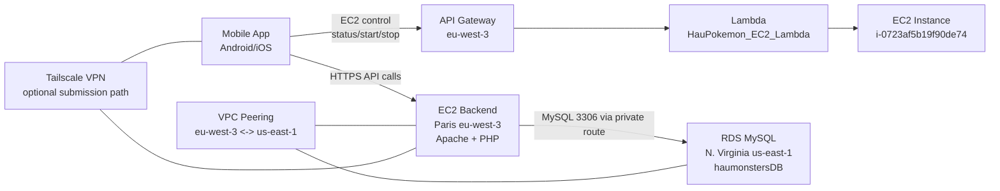

# AWS Architecture and Cost Estimate

Updated: March 27, 2026

## 1) Deployed Cloud Architecture

## 2) Components in Use

- EC2 (eu-west-3): PHP backend host
- RDS MySQL (us-east-1): main database (`haumonstersDB`)
- API Gateway + Lambda (eu-west-3): EC2 control even when backend EC2 is down
- VPC Peering: private connectivity between Paris backend VPC and N. Virginia DB VPC
- Tailscale: VPN access path for required testing/demo

## 3) Monthly Cost Estimate (Student/Dev Profile)

This estimate assumes low-to-moderate class/demo usage and mostly single-instance runtime.

### A) EC2 backend (eu-west-3)
- 1 small Linux instance (always on)
- EBS root volume (~8-20 GB gp3)
- Estimated: **~$8 to $18 / month**

### B) RDS MySQL (us-east-1)
- Single-AZ `db.t4g.micro`
- 20 GB storage
- Estimated: **~$14 to $25 / month**

### C) API Gateway + Lambda (EC2 control only)
- Very low traffic (status/start/stop calls)
- Estimated: **~$0 to $2 / month**

### D) Data transfer / peering traffic
- Small app payloads, class/demo usage
- Estimated: **~$1 to $6 / month**

### E) Tailscale
- Personal/small-team tier
- Estimated: **$0 / month** (if staying within free tier limits)

## 4) Total Estimated Monthly Cost

- **Expected range: ~$23 to $51 per month**
- Practical target for this project: **around ~$30 to $40 per month**

## 5) Notes for Final Report

- Final actual billing depends on:
  - EC2 uptime hours
  - RDS instance hours
  - Storage growth
  - Inter-region transfer volume
- For professor submission, include this estimate as a projection and mention that final AWS bill is usage-based.
- Release Android artifact generated at:
  - `release/HAUPokemon-v1-release.apk`
